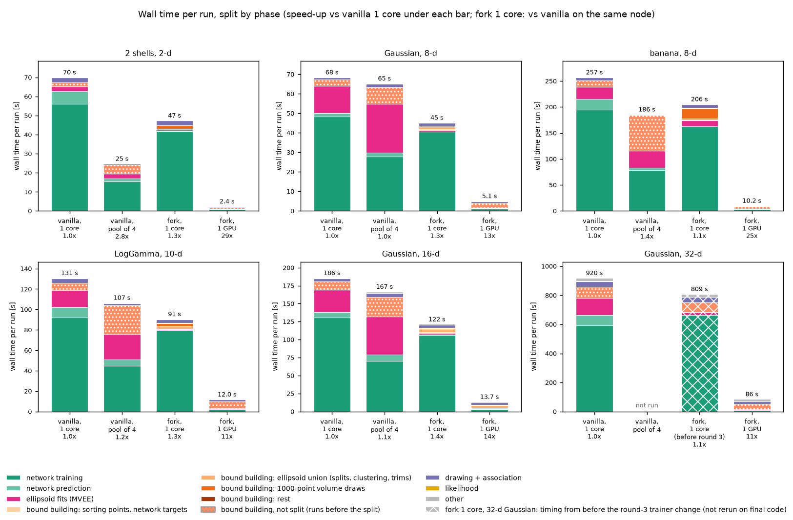
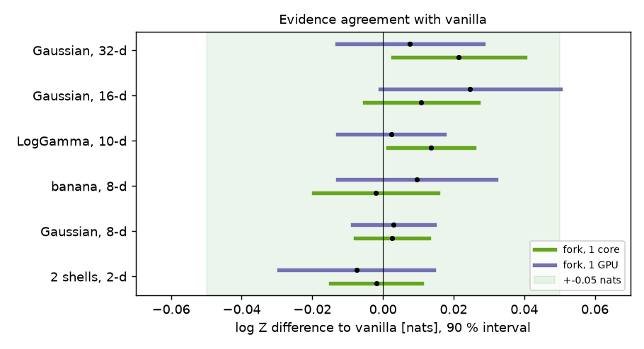
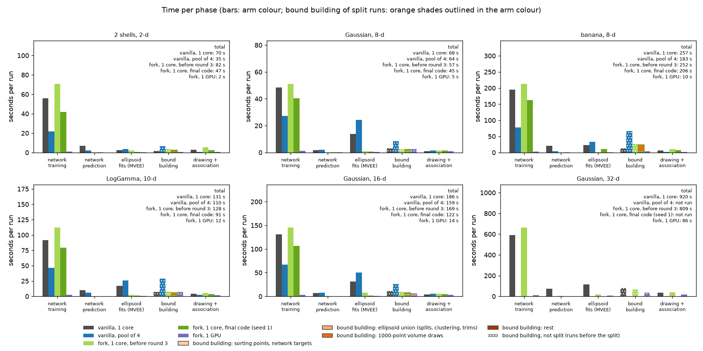
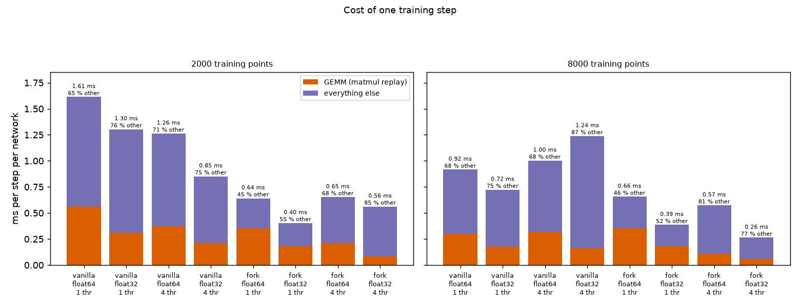
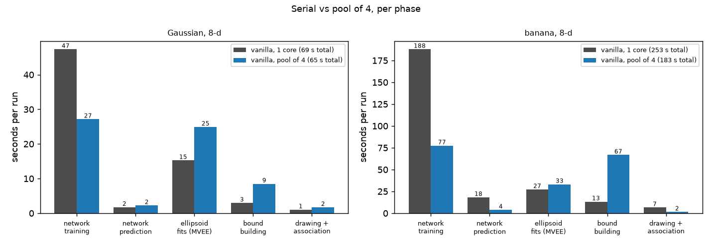

# Benchmarks: nautilus GPU fork vs nautilus 1.0.6

Draft, 2026-10-27. The fork is nautilus 1.0.6 plus an optional PyTorch backend. Vanilla means nautilus 1.0.6 from
its release tag. Both ran from source trees shipped together, on LUMI (AMD EPYC CPU cores; one AMD MI250X GCD).

## Arms
| label | what |
|---|---|
| vanilla, 1 core | nautilus 1.0.6, serial, 1 CPU core, scikit-learn networks in float64 |
| vanilla, pool of 4 | nautilus 1.0.6 with `pool=(None, 4)`: 4 worker processes for network training and bound sampling, 4 cores, 1 BLAS thread each |
| fork, 1 core | the fork with `backend='torch', device='cpu'`, float64 networks, 1 core (final trainer, which drops stopped networks) |
| fork, 1 GPU | the fork with `backend='torch', device='cuda'` on one GCD, float32 networks (`NN_DTYPE`), fused kernels (`DRAW_KERNEL`, `TRAIN_KERNEL`) |

Without a `backend` argument the fork gives the same output as 1.0.6 bit for bit: same points, likelihood calls,
shells and log Z on all six test problems (seeds 1 and 2), and also with `pool=(None, 4)`.

## Test problems
Every problem lives in the unit cube with a uniform prior, and log Z is known (`payload/problems.py`):
- 2 Gaussian shells, 2-d (Feroz et al. 2009);
- correlated Gaussians, 8-, 16- and 32-d;
- Rosenbrock-type banana, 8-d;
- the four-mode LogGamma problem, 10-d (Beaujean & Caldwell 2013, as in the nautilus paper).

Settings for every arm: n_live 500, n_eff 2000, every other setting at its Nautilus default. The likelihoods are
cheap and vectorised, so these runs measure the sampler's own overhead.

## Wall time

`figs/headline.png`. Wall time of one run per arm, stacked by phase on a linear axis (same phases and colours as
`figs/toys_phases.png`), with the total above each bar and the speed-up over vanilla, 1 core under it. Time outside
the wrapped phases is counted as "other". The likelihood phase is drawn but is below a second on every problem.
- **Vanilla, 1 core:** mean over seeds (10 per problem; 7 for the banana).
- **Vanilla, pool of 4:** measured on a login node against serial vanilla on the same node and seeds (1-2 seeds), then
  scaled to the vanilla bar by that same-host ratio, every phase by the same factor. Its phases are those of the
  main process, so time spent waiting for the workers lands in the phase that waits. It was not run on the 32-d Gaussian.
- **Fork, 1 core:** one seed-1 run with the final code, run at the same time on the same compute node as a seed-1
  vanilla, 1 core run (3 single-core runs side by side). Its speed-up is against that same-node vanilla run, not against
  the vanilla bar. The exception is the 32-d Gaussian, where the bar is the mean over 10 seeds of the fork's earlier
  trainer (before it dropped stopped networks), from the same batch as the vanilla bar.
- **Fork, 1 GPU:** one run with seed 1. Two bars come from a process whose fused kernels were already compiled: the 2-d
  shells (a second seed-1 run in the same process) and the 16-d Gaussian (a later job, with the kernel cache filled and
  the phases synchronised; same points and log Z as the first run, which took 17.4 s, about 4 s of it the one-time
  compile of the 16-d draw kernel).

| problem | vanilla, 1 core | vanilla, pool of 4 | fork, 1 core | fork, 1 GPU |
|---|---|---|---|---|
| 2 shells, 2-d | 70 s | 25 s (2.8x) | 47 s (1.3x) | 2.4 s (29x) |
| Gaussian, 8-d | 68 s | 65 s (1.05x) | 45 s (1.3x) | 5.1 s (13x) |
| banana, 8-d | 257 s | 186 s (1.4x) | 206 s (1.1x) | 10.2 s (25x) |
| LogGamma, 10-d | 131 s | 107 s (1.2x) | 91 s (1.3x) | 12.0 s (11x) |
| Gaussian, 16-d | 186 s | 167 s (1.1x) | 122 s (1.4x) | 13.7 s (14x) |
| Gaussian, 32-d | 920 s | - | 809 s (1.1x; earlier trainer) | 86 s (11x) |

**Fork on 1 CPU core, float64 vs float32 networks** (seed 1, the three runs side by side on one compute node; table
only). float32 is what the GPU arm uses; its log Z equivalence over seeds was tested on the GPU only, not on the CPU.

| problem | vanilla: wall, log Z - truth | fork float64: wall (speed-up), log Z - truth | fork float32: wall (speed-up), log Z - truth |
|---|---|---|---|
| 2 shells, 2-d | 62.1 s, +0.027 | 47.5 s (1.31x), -0.011 | 29.8 s (2.08x), +0.019 |
| Gaussian, 8-d | 60.5 s, +0.003 | 45.3 s (1.34x), -0.013 | 31.8 s (1.90x), +0.014 |
| banana, 8-d | 226.8 s, +0.007 | 205.6 s (1.10x), -0.003 | 119.4 s (1.90x), -0.010 |
| LogGamma, 10-d | 117.0 s, -0.012 | 90.6 s (1.29x), +0.034 | 58.2 s (2.01x), -0.003 |
| Gaussian, 16-d | 168.6 s, -0.013 | 121.5 s (1.39x), -0.006 | 80.4 s (2.10x), +0.015 |

The float32 runs differ from vanilla by -0.017 to +0.028 nats in this one seed, inside the noise of a single run
(the per-seed spread is 0.01-0.03 nats), but one seed is no equivalence test.

## Accuracy

`figs/toys_equivalence.png`. Mean log Z of each fork arm minus that of vanilla, with 90 % intervals, against a +-0.05-nat
margin.

log Z - truth (nats), mean +- standard error (number of seeds):

| problem | vanilla, 1 core | fork, 1 core | fork, 1 GPU |
|---|---|---|---|
| 2 shells, 2-d | +0.007 +- 0.005 (10) | +0.005 +- 0.006 (5) | -0.001 +- 0.012 (5) |
| Gaussian, 8-d | -0.000 +- 0.004 (10) | +0.003 +- 0.005 (10) | +0.003 +- 0.006 (6) |
| banana, 8-d | -0.003 +- 0.007 (7) | -0.005 +- 0.008 (8) | +0.007 +- 0.012 (5) |
| LogGamma, 10-d | -0.008 +- 0.005 (10) | +0.006 +- 0.006 (10) | -0.006 +- 0.008 (5) |
| Gaussian, 16-d | -0.015 +- 0.007 (10) | -0.005 +- 0.007 (10) | +0.009 +- 0.014 (5) |
| Gaussian, 32-d | -0.059 +- 0.009 (10) | -0.038 +- 0.007 (10) | -0.052 +- 0.009 (5) |

- **Fork, 1 core:** its 90 % interval for the difference to vanilla lies inside +-0.05 nats on the four problems with 10
  seeds per arm. The banana and the shells are also inside the margin, with fewer seeds.
- **Fork, 1 GPU:** inside the margin on every problem, but with only 5-6 seeds. On the 16-d Gaussian the upper end
  reaches +0.050. So equivalence for the GPU arm is indicated, not established.
- **No arm** differs from vanilla by more than 3 standard errors.
- **The 32-d Gaussian** is biased low in every arm by the same amount (n_live 500 is small for 32 dimensions).

The fused draw kernel gives the same points as the plain GPU path. The float32 networks and the training kernel change
the result at rounding level, so their runs are compared statistically.

## Where the time goes

`figs/toys_phases.png`. Seconds per run in each phase, per arm, from an exclusive host-wall split (time goes to the
innermost active phase), mean over seeds. On the GPU, the host waits for asynchronous device work in the phase that
waits.

The phases:
- **Network training:** fitting the 4 emulator networks of a new bound.
- **Network prediction:** evaluating them outside training.
- **Ellipsoid fits:** minimum-volume enclosing ellipsoids.
- **Bound building:** the rest of `Sampler.add_bound`, split into four parts (below).
- **Drawing + association:** `sample_shell` and `shell_association`.

The likelihoods here are cheap, so the likelihood phase is negligible and is not drawn.

**What bound building contains.** Each new bound runs `Sampler.add_bound`. Network training, network prediction and the
ellipsoid fits are counted in their own phases. The rest is split by wrappers in the benchmark's timing harness
(`payload/timing.py`; the sampler code is unchanged, and the runs give the same points as unwrapped ones):
1. **Sorting points, network targets:** `add_bound`'s own work (concatenating and sorting all points by likelihood to
   find the new threshold, shell bookkeeping) plus `NeuralBound.compute`'s own work (selecting the points inside the
   ellipsoid, rescaling the training targets, choosing the network score threshold).
2. **Ellipsoid union:** fitting the ellipsoids and the outer union (`Ellipsoid` / `UnitCubeEllipsoidMixture` /
   `Union.compute`), splitting by clustering, the volume and overlap checks of the split loop, and trimming.
3. **1000-point volume draws:** estimating the new bound's volume (`NautilusBound.sample` inside `add_bound`). On the
   GPU with the fused draw kernel, this is where the kernel is compiled on first use.
4. **Rest:** `NautilusBound.compute`'s own work (selecting each ellipsoid's points, the loops around the steps above).

Only the runs of the last round have the split: vanilla and fork on 1 core (5 problems, seed 1) and the GPU run of the
16-d Gaussian. Earlier runs show bound building as one hatched block. Seconds per run (table only, except the bars of
`figs/headline.png` and `figs/toys_phases.png`):

| run | bound building | sorting, targets | ellipsoid union | volume draws | rest |
|---|---|---|---|---|---|
| Gaussian 16-d, fork, 1 GPU (synchronised) | 5.2 | 0.7 | 3.9 | 0.2 | 0.4 (8 %) |
| Gaussian 16-d, vanilla, 1 core | 10.1 | 1.6 | 7.3 | 0.6 | 0.5 (5 %) |
| Gaussian 16-d, fork, 1 core | 7.6 | 1.4 | 4.3 | 1.5 | 0.4 (5 %) |
| banana 8-d, vanilla, 1 core | 11.8 | 0.4 | 5.6 | 5.6 | 0.2 (2 %) |
| banana 8-d, fork, 1 core | 23.7 | 0.6 | 2.9 | 20.0 | 0.2 (1 %) |
| LogGamma 10-d, vanilla / fork, 1 core | 6.5 / 5.9 | 0.5 / 0.4 | 3.5 / 2.0 | 2.4 / 3.3 | 0.2 / 0.1 |

- The rest stays at or below 8 % of bound building in every run, so nothing large is unaccounted for.
- **On the GPU, the ellipsoid union dominates** (3.9 of 5.2 s on the 16-d Gaussian): small sequential host work
  (clustering, split-loop volume checks) that would not gain on a device.
- **On one CPU core, the fork's volume draws are slower than vanilla's** where many draws are rejected: 20.0 vs 5.6 s on
  the banana, 1.8 vs 0.7 s on the shells. The fork runs these draws through its torch path, which pays off on a GPU but
  not on a CPU. The fork's ellipsoid union is faster than vanilla's (2.9 vs 5.6 s, 4.3 vs 7.3 s).
- A one-time numba compile (8 s) lands in the first ellipsoid fit of a process; on the GPU arm `warm_up()` pays it
  before the timed run.

**Why the 2-d shells first looked slow on the GPU.** The fused draw kernel is compiled with `hipcc` on first use, once
per (padded dimension, network precision), and cached on disk.
- The cache timestamps show that the float32 2-d kernel was built during the shells seed-1 run.
- That run spent 10.9 s in other bound building. Later runs with the cached kernel spent 2.0-2.8 s in that phase, even
  with 3 runs sharing the GPU.
- The plain-GPU run spent 1.5 s there, and the first run with the fused kernel in float64 spent 4.6 s.

A synchronised repeat in one process confirms it: with an empty kernel cache, the shells seed-1 run took 8.5 s; the
same run again in the same process took 2.4 s (0.29x), with identical likelihood calls and log Z. Other bound
building fell from 6.7 to 0.8 s, so about 6 s of the cold run was the compile. The cache is persistent
(`$NAUTILUS_KERNEL_CACHE`, default `~/.cache/nautilus`) and keyed on the kernel source, compiler flags, GPU
architecture, precision and (for the draw kernel) the padded dimension and network widths, so later runs and later
processes do not pay it again. `nautilus._torch.warm_up()` covers the training kernels, but not the per-dimension
draw kernel.

The batched ellipsoid fit uses numba with `cache=True`. numba keys its on-disk cache on the source file's location,
so a run from a freshly unpacked copy of the package (as in these benchmark jobs) compiles it again (about 8 s; on
the GPU arm `warm_up()` pays this before the timed run). An installed package at a stable path keeps the cache.

**Why the torch backend gains little on a CPU.** `fork, 1 core` (the trainer before the change below) takes
0.82-1.04x vanilla's wall time:
- At d >= 8 its ellipsoid fits take 6-24 % of vanilla's time (batched algorithm), and network prediction almost disappears.
- Training does not get faster. The fork trains the 4 networks stacked, as one batched model, and stops when the last
  network meets its early-stopping criterion.
  - On the banana, vanilla's 4 networks took 207 015 single-network steps (51 754 each on average). The fork's stacked
    trainer took 71 536 steps, 1.38x more per network.
  - The spread is the same one seen in vanilla: the slowest of 4 networks takes 1.27x the mean fit time.
- Each stacked step is cheaper per network than scikit-learn's, but the extra steps eat that gain.

**Dropping stopped networks.** Stopped networks were already frozen (their Adam step is multiplied by an active mask,
so they do not over-train); they were still computed. The trainer now removes a stopped network from the stack at the
next epoch boundary and keeps at least two stacked (a single network would switch torch to unbatched matrix products,
which round differently). The output is bit for bit unchanged: same weights, loss curves, epochs and best losses in
3 direct trainings, and the same points and log Z on all 6 problems (seed 1; banana also seed 2). Measured on the same
node against the previous trainer (table only, `round3_train.json`; the final code is the dark-green arm of `figs/toys_phases.png`):

| problem | training time | run time |
|---|---|---|
| 2 shells, 2-d | 0.95x | 0.96x |
| Gaussian, 8-d | 0.69x | 0.71x |
| banana, 8-d (compute node, 2 seeds) | 0.87x | 0.90x |
| LogGamma, 10-d | 0.94x | 0.96x |
| Gaussian, 16-d | 0.87x | 0.88x |
| Gaussian, 32-d | 0.92x | 0.94x |

All but the banana are single seed-1 runs on a shared login node, so they carry a few percent of noise. A stacked step
of 2 networks costs 0.64-0.80x one of 4, so the saving is bounded by how long the slowest network outlasts the others.
With the change, `fork, 1 core` takes 0.72-0.91x the wall time of vanilla on the same node (table above). The GPU
trainers are unchanged. The HIP training kernel already skips stopped networks (their workgroups leave the epoch loop).
The CUDA-graph trainer keeps the masked fixed-size stack: dropping stopped networks there means re-capturing the epoch
graphs, and on one MI250X GCD (8-d Gaussian, seed 1, float64, two runs per variant in one warm process) that trained
**1.7x slower** (16.6-16.8 s vs 9.8-9.9 s; run 20.0-20.2 s vs 13.2-13.3 s). It gave the same points and log Z, but
not bit-identical networks: 102 of 156 networks differ at rounding level, because batched GPU matrix products of
different batch sizes round differently. That variant was therefore not adopted (table only).

## Training step cost

`figs/train_probe.png`. Time per Adam step per network (16-d inputs, (100, 50, 20) network, batch 200, 20 epochs, 2000
or 8000 points), split into the matrix products (timed by replaying the same products) and everything else. Measured on
a shared login node with 4 pinned cores.
- **Vanilla (scikit-learn):** 0.9-1.6 ms per step, 65-76 % outside the matrix products at 1 thread.
- **Fork (stacked torch, 1 thread):** 0.64 ms per network in float64 and 0.39-0.40 ms in float32, 45-55 % outside them.
- **More threads:** 4 threads do not help either code, because the products are too small to split.

## Vanilla with a pool of 4

`figs/pool_phases.png`. Seconds per phase, serial vs `pool=(None, 4)`, on the same login node (seed 1).
- **Training is limited by the slowest network:** with 4 networks per bound, the sum of the per-bound maximum fit times
  caps the pool's training speed-up at 3.1x (8-d Gaussian and banana). The measured gain is 1.7-2.4x.
- **Bound building grows** (3 → 9 s on the 8-d Gaussian, 13 → 67 s on the banana) from waiting on the pool: the
  1000-point volume draws are sent to the workers and the results read back (19-43 s in `recv` on the banana). Sending
  the work is cheap (0.5 s of pickling).
- **The ellipsoid fits slow down** (15 → 25 s, 27 → 33 s) although both arms use 1 BLAS thread, so it is not BLAS.
  The likely cause, not verified, is the main process competing with the pool's helper threads and workers.

Recommended CPU setting: `pool=(None, 4)` with `OMP_NUM_THREADS=1`, which was 1.05-2.8x faster here. One process with 4
BLAS threads was slower than 1 thread on 7 of 9 problem-seeds. The pool changes the random draws, so its log Z is a
different realisation; it stayed within +-0.04 nats of the truth on the 9 runs.

## Limits
- **GPU timings:** one seed per problem. The GPU arm has 5-6 accuracy seeds per problem (8 or more are needed for a
  formal +-0.05-nat equivalence test).
- **Hosts:** the vanilla timings mix compute nodes and lightly shared login nodes. The pool timings come from a shared
  login node.
- **Fork, 1 core (final code) and the bound-building split:** one seed per problem. The 32-d Gaussian's fork, 1 core
  bar is from the earlier trainer.
- **Bound-building split on the GPU:** measured on the 16-d Gaussian only.

## Reproduce
- `payload/problems.py`, `run.py` and `timing.py` define the problems, run one sampler run and split its wall time.
- `drive.sh` runs a queue of runs. The analysis scripts are `analyse_toys.py`, `figures.py`, `headline.py`, `probe_fig.py`
  and `prof.py`.
- Raw results are under `payload/runs/` and `fetched/`.
